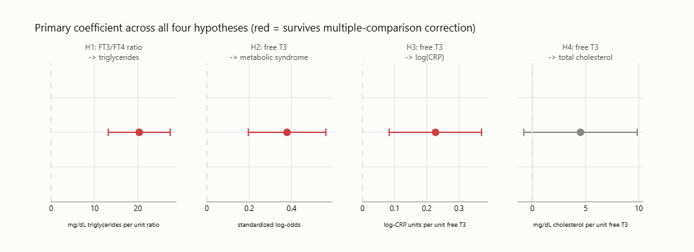
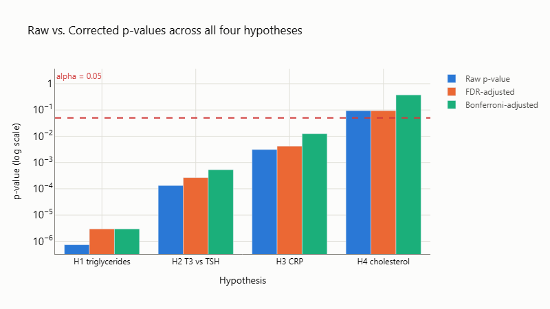
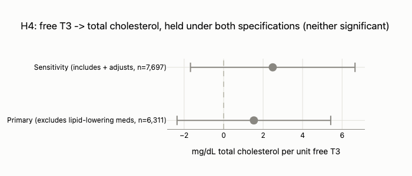
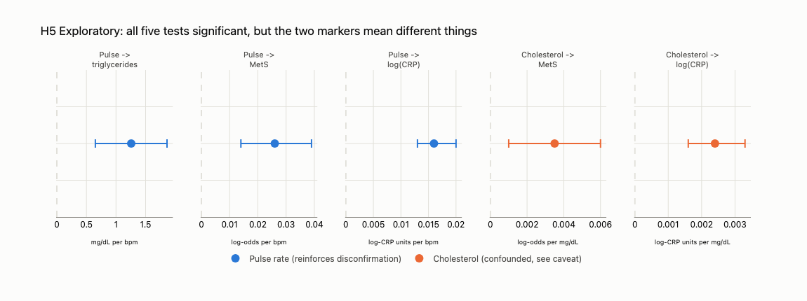

# Project Bioenergetics

This project uses NHANES public health data to test Ray Peat's bioenergetic
hypotheses about thyroid function and metabolic health in U.S. adults.

Peat's framework holds that efficient conversion of T4 to T3 and adequate free
T3 support an efficient, pro-metabolic physiology that protects against
elevated triglycerides, inflammation, and other markers of metabolic
dysfunction. This project asks whether that framework holds up against
national health survey data. It does not. Judged against their
pre-specified falsification criteria, three of the four hypotheses are
falsified and one is supported as worded, and none produced evidence in the
direction the framework predicts. Two associations that the framework
expects to be protective, the FT3/FT4 ratio with triglycerides (H1) and free
T3 with CRP (H3), are significant in the opposite direction after correction
for multiple comparisons. Free T3 shows no significant association with
total cholesterol in the primary model (H4). Free T3 predicts metabolic
syndrome better than TSH (H2), as hypothesized, but higher free T3 is
associated with higher odds of metabolic syndrome. A post-hoc exploratory section (H5) tests two "practical" markers that the
framework's proponents prefer over serum thyroid tests, and its results do
not change this conclusion.

This README is the full technical write-up. A shorter, more personal account
of the project is available at
[connor.day/projects/bioenergetics](https://www.connor.day/projects/bioenergetics).
The analysis was revised in November 2026, and the
[revision note](#revision-note) at the end of this document describes what
changed.

## Data

The analysis uses [NHANES](https://www.cdc.gov/nchs/nhanes/) (National Health
and Nutrition Examination Survey) cycles 2007-2008, 2009-2010, and 2011-2012,
which are the only three cycles with a full thyroid panel (free T3, free T4,
TSH, and total T3/T4). NHANES is a stratified, multistage probability sample
of the U.S. civilian population, so all analyses use design-based survey
weights, strata, and primary sampling units (PSUs) in place of unweighted
statistics.

The study population for all hypotheses is non-pregnant adults aged 20 and
older, excluding participants with self-reported thyroid disease and users of
thyroid or antithyroid medication. Hypothesis-specific exclusions, such as
restriction to the fasting subsample and exclusion of lipid-lowering
medication users, are documented under each hypothesis below and in
[`docs/hypotheses.md`](docs/hypotheses.md).

One record (SEQN 53952) is excluded from all models as a laboratory or
recording error. Its free T3 of 28.84 pg/mL is roughly seven times the upper
reference limit, while its total T3 of 121 ng/dL is normal, and the two
values cannot both be correct. The exclusion rule, free T3 above 8.4 pg/mL
with total T3 at or below 200 ng/dL, matches no other participant.
Participants with concordantly high free and total T3 and suppressed TSH are
retained as cases of undiagnosed hyperthyroidism. Because this single record
has a large influence on H2 and H3, results with it retained are reported in
[`notebooks/09_robustness_checks.ipynb`](notebooks/09_robustness_checks.ipynb)
and summarized under each hypothesis.

## Methodology

Models are survey-weighted regressions fit with [`svy`](https://svylab.com).
In 2007-2008 the thyroid panel was measured on the full examination sample,
but from 2009-2010 onward it was measured on a random one-third subsample
that CDC weights with `WTSA2YR`. Each analysis therefore uses a
thyroid-adjusted weight (`wt_thyroid_2yr`, defined in
[`pipeline/nhanes_helpers.py`](pipeline/nhanes_helpers.py)). For non-fasting
outcomes this is `WTMEC2YR` in 2007-2008 and `WTSA2YR` thereafter. For
fasting-subsample outcomes it is `WTSAF2YR` in 2007-2008 and, thereafter,
`WTSAF2YR` multiplied by each participant's thyroid subsampling factor
(`WTSA2YR / WTMEC2YR`). NHANES publishes no weight for the intersection of the
fasting and thyroid subsamples, so this product treats the two subsamples as
independent. It brings each later cycle's weighted total to within 5% of the
2007-2008 total. Weights are pooled across cycles by dividing by the number
of cycles combined, which is the standard NHANES approach to multi-cycle
analysis.

Each model adjusts for age and sex. The first H1 model and its total T3/T4
counterpart estimate the total association and stop there, and the H5
calibration check is unadjusted. All other models also adjust for BMI, and
some add further covariates (for example, lipid-lowering medication use in the H4
sensitivity model). Analytic subsets are formed before the survey design is
specified. Every subset retains all strata with at least two PSUs each, so
the Taylor-linearized standard errors equal those from formal domain
estimation.

Medication use is identified from the NHANES prescription file (`RXQ_RX`)
linked to the drug lookup table (`RXQ_DRUG`). A drug counts toward a class if
that class appears in any of its four therapeutic category slots, which
captures combination products such as amlodipine with atorvastatin.

Metabolic syndrome, the outcome for H2, follows the 2009 Harmonized criteria
([Alberti et al., *Circulation* 2009](https://doi.org/10.1161/CIRCULATIONAHA.109.192644)),
including the drug-treatment alternate indicators that those criteria
specify. Participants with missing components are classified as definite
positive, definite negative, or ambiguous, and only the ambiguous group is
excluded. A single missing laboratory value therefore does not remove a
participant from the analysis.

Multiple-comparison correction (FDR and Bonferroni) is applied across the
primary tests of all four hypotheses, because evaluating several hypotheses
at p < 0.05 without correction overstates the strength of the evidence. The
pre-specified criterion for H2 is a comparison of AUCs, which has no p-value,
so the free T3 coefficient from the H2 model represents H2 in the correction.

The hypotheses and falsification criteria were set before the models were
fit. The hypotheses document was committed to this repository after the
analyses were complete, however, so the repository does not provide a
timestamped record of that order, and the hypotheses are described here as
pre-specified rather than pre-registered.

The pipeline is reproducible from public data. `pipeline/01_download.py`
downloads the raw NHANES `.XPT` files from CDC into `data/raw/`, which is
git-ignored. The remaining scripts in `pipeline/`, numbered by run order,
build cleaned and merged analytic samples from those files, and the notebooks
in `notebooks/` carry out exploration and modeling. The processed samples in
`data/processed/` are committed so that the notebooks run without the raw
files.

## Findings

| # | Hypothesis | Result | Direction |
| --- | --- | --- | --- |
| H1 | A higher FT3/FT4 ratio is associated with lower triglycerides | Falsified. The association is significant in the opposite direction and survives multiple-comparison correction. | Opposite |
| H2 | Free T3 predicts metabolic syndrome better than TSH | Supported as worded, by a small and untested margin. Free T3 leads on AUC, AIC, and the standardized coefficient, but higher free T3 is associated with higher odds of metabolic syndrome. | Opposite to the framework |
| H3 | Lower free T3 is associated with higher CRP (inflammation) | Falsified. The association is significant in the opposite direction and survives multiple-comparison correction. | Opposite |
| H4 | Higher free T3 is associated with lower total cholesterol | Falsified. The primary model shows a positive association that is not significant, and the sensitivity model shows a significant positive association. | None (primary), opposite (sensitivity) |

| # | Primary coefficient (95% CI) | n | p (raw) | p (FDR) | p (Bonferroni) |
| --- | --- | --- | --- | --- | --- |
| H1 | +20.3 mg/dL per unit ratio (13.2 to 27.5) | 3,458 | <0.001 | <0.001 | <0.001 |
| H2 | +0.38 log-odds per SD of free T3 (0.20 to 0.56) | 3,371 | <0.001 | <0.001 | <0.001 |
| H3 | +0.23 log-CRP per pg/mL free T3 (0.08 to 0.37) | 6,270 | 0.003 | 0.004 | 0.012 |
| H4 | +4.5 mg/dL per pg/mL free T3 (-0.8 to 9.8) | 6,283 | 0.094 | 0.094 | 0.375 |

Each hypothesis is falsified if its association is null or runs in the
direction opposite to the one predicted, except H2, which is falsified if
TSH's AUC equals or exceeds free T3's. By those criteria H1, H3, and H4 are
falsified. H1 and H3 are falsified with statistical significance, and in both
cases the association runs opposite to the framework's prediction. A higher
free-T3/free-T4 ratio is associated with higher triglycerides, and higher
free T3 is associated with higher CRP. H4 is falsified because its primary
association is null. H2 is the only hypothesis that meets its criterion, but
the free T3 association it rests on is itself positive, so higher free T3
goes with more metabolic syndrome.

Excluding the record with an implausible free T3 value changes no verdict.
With the record retained, H2 and H3 lose statistical significance, but H3
remains falsified because its criterion includes a null result, and free T3
still has the higher AUC in H2 (0.828 against 0.824).





### H1. FT3/FT4 ratio and triglycerides

Two models were fit. The first adjusts for age and sex and estimates the
total association. The second adds BMI and estimates the association
independent of body size, since BMI is a plausible mediator between thyroid
function and triglycerides. The coefficient changed little between the two
models (20.3 and 19.7 mg/dL per unit of the ratio, both p < 0.001), which
indicates that body size does not substantially explain the association.

A sensitivity check replaced free T3 and free T4 with total T3 and total T4
(`LBXTT3`/`LBXTT4`). Peat's writing is explicitly skeptical of free hormone
measurements as a proxy for biological activity and favors total hormone
levels. The total-hormone ratio gave the same direction, with a coefficient
of +2.97 in the first model and +2.99 in the second (p = 0.024 in both). The
H1 finding therefore does not depend on the choice between free and total
hormone measurements.

H1 is the most stable result in the project. It is significant under the
original and corrected weights, with and without the excluded record, among
euthyroid participants (TSH 0.4 to 4.5 mIU/L), among participants negative
for thyroid peroxidase antibodies, and in the 2007-2008 cycle alone (all
p < 0.002).

### H2. Free T3 and TSH as predictors of metabolic syndrome

The two markers were compared on three pre-specified metrics, with each
marker standardized and added to a model containing age, sex, and BMI
(n = 3,371). Free T3 leads on all three. Its AUC was 0.829 against 0.824 for
TSH, its AIC was lower (3,275 against 3,307), and its standardized
coefficient was larger and significant (0.38, p < 0.001) where TSH's was not
(0.16, p = 0.058). By the stated criterion, which falsifies H2 only if TSH's
AUC equals or exceeds free T3's, H2 is supported. No formal test of the
difference between the two AUCs was computed, so the margin of 0.005 has no
associated measure of uncertainty.

Two qualifications apply. First, neither marker adds much to the covariates.
A model with age, sex, and BMI alone has an AUC of 0.823, so free T3 adds
0.006 and TSH adds 0.001. Second, the free T3 coefficient is positive, so
higher free T3 is associated with higher odds of metabolic syndrome. The
framework's premise is that adequate free T3 protects against metabolic
dysfunction, and this result runs against that premise even though it
satisfies the hypothesis as worded.

The free T3 association is sensitive to the excluded record. With that record
retained, the coefficient is similar (0.34) but its confidence interval
roughly doubles in width, and it is not significant (p = 0.083). Free T3's
AUC remains higher than TSH's (0.828 against 0.824), so the verdict on H2 is
unchanged. The association is significant among euthyroid participants (p < 0.001) and among antibody
negative participants (p < 0.001), but not in the 2007-2008 cycle alone
(p = 0.105).

### H3. Free T3 and CRP (inflammation)

CRP was measured only in the 2007-2008 and 2009-2010 cycles, so this
hypothesis uses a two-cycle pooled sample (n = 6,270) with its own pooled
weight. CRP is heavily right-skewed (mean 0.42, median 0.19, maximum
20 mg/dL), and the primary model therefore uses log-transformed CRP, which is
standard practice for this outcome. In that model, free T3 was positively
associated with CRP (coefficient 0.23 per pg/mL, p = 0.003), the opposite of
the hypothesized direction. Each additional 1 pg/mL of free T3 corresponds to
roughly 25% higher CRP. The result survives correction for multiple
comparisons (FDR-adjusted p = 0.004, Bonferroni-adjusted p = 0.012). A
sensitivity check on untransformed CRP, which is less reliable given the
skew, found no association (p = 0.63).

The association holds among euthyroid participants (p < 0.001), among
antibody negative participants (p < 0.001), and in the 2007-2008 cycle alone
(p = 0.023). With the excluded record retained, it is weaker and not
significant (coefficient 0.12, p = 0.072).

The central caveat for this hypothesis is non-thyroidal illness syndrome, in
which illness suppresses T3 while independently raising CRP. That mechanism
would produce a spurious negative correlation and does not explain the
positive association observed here, so no causal interpretation is offered in
either direction. Cross-sectional data cannot establish causal direction.

### H4. Free T3 and total cholesterol

Total cholesterol is measured in the full (non-fasting) MEC examination
sample, which gives H4 the largest pooled sample of the four hypotheses. The
primary model excluded users of any drug in the `ANTIHYPERLIPIDEMIC AGENTS`
class (statins, fibrates, ezetimibe, bile acid sequestrants, niacin, and
PCSK9 inhibitors), leaving n = 6,283. Free T3 was positively but not
significantly associated with total cholesterol (4.5 mg/dL per pg/mL,
p = 0.094). A sensitivity model retained medication users and adjusted for
medication use (n = 7,696). In that model the positive association was
significant (6.0 mg/dL per pg/mL, p = 0.021).

H4 is falsified under its criterion, since neither model shows lower
cholesterol with higher free T3. The positive association is not
consistent, however. It is significant among euthyroid participants
(p = 0.008) and antibody negative participants (p = 0.024) but absent in the
2007-2008 cycle alone (p = 0.79), so H4 is reported as a null primary result
with an unstable positive association.



## H5. Exploratory analysis of "practical" thyroid markers (post-hoc)

Commentators in the bioenergetic community on X/Twitter (for example, Danny
Roddy) argue that circulating free T3, free T4, and TSH are poor proxies for
tissue-level thyroid status, and they prefer resting pulse rate, basal body
temperature, total cholesterol, and prolactin. Body temperature and prolactin
are not available in these NHANES cycles. Resting pulse rate (`BPXPLS`) and
total cholesterol (`LBXTC`, also used in H4) are available, so this section
tests those two markers against the same three outcomes (triglycerides,
metabolic syndrome, and log-CRP). Each model reuses the population, weights,
and covariate adjustment of the corresponding hypothesis (H1, H2, or H3) so
that the results are directly comparable.

This section is post-hoc and exploratory. It was added after the H1-H4
results were known and was not pre-specified. That sequence carries a
methodological risk. Within the Peat framework, declaring the serum markers
invalid because they produced unfavorable results, and then substituting the
markers that the framework's proponents prefer, would make the framework
unfalsifiable. This section is intended to test the alternative markers on
their own terms rather than to rescue H1-H4, and its results are reported in
the same way regardless of their direction. The H5 tests are corrected as a
separate multiplicity family from H1-H4, because combining a pre-specified
confirmatory set with a post-hoc exploratory set would obscure the meaning of
each corrected p-value.

Pulse-rate models exclude beta-blocker users, including users of
beta-blocker and thiazide combinations. This exclusion is narrower than H2's
broad antihypertensive category and was chosen because beta-blockers suppress
heart rate pharmacologically, independent of thyroid status, and would
otherwise confound any pulse-based result. Cholesterol models exclude users
of any lipid-lowering drug, whose cholesterol reflects the medication rather
than thyroid status.

| Test | Coefficient | p (raw) | p (FDR) | p (Bonferroni) | Direction |
| --- | --- | --- | --- | --- | --- |
| Calibration check, pulse ~ free T3 (descriptive) | +3.52 | <0.001 | n/a | n/a | Higher free T3 is associated with higher pulse, as expected (thyroid hormone raises heart rate) |
| Pulse and triglycerides | +1.28 | 0.0026 | 0.0026 | 0.013 | Opposite to the framework |
| Pulse and metabolic syndrome | +0.026 | <0.001 | <0.001 | 0.0013 | Opposite to the framework |
| Pulse and log-CRP | +0.018 | <0.001 | <0.001 | <0.001 | Opposite to the framework |
| Cholesterol and metabolic syndrome | +0.0066 | 0.0011 | 0.0014 | 0.0057 | Consistent with the framework in direction (see caveat below) |
| Cholesterol and log-CRP | +0.0018 | <0.001 | 0.0012 | 0.0036 | Consistent with the framework in direction (see caveat below) |

All five formal tests survive correction, but the two markers support
different conclusions.



Pulse rate reinforces the original disconfirmation. All three pulse models
point in the same direction as the free T3 findings, opposite to the
framework's prediction. The calibration check shows that these results are
consistent with each other. Free T3 correlates positively with pulse, as
expected from standard endocrinology, since thyroid hormone raises heart rate
regardless of the Peat framework. Both markers independently predict worse
metabolic outcomes, and agreement between two physiologically linked markers
is stronger evidence against the hypothesis than either marker alone.

The cholesterol results require a substantial caveat. Ordinary
cardiometabolic physiology fully explains why higher cholesterol would
predict metabolic syndrome and elevated CRP, because dyslipidemia routinely
clusters with insulin resistance and low-grade inflammation without any
involvement of thyroid function. These data cannot distinguish between
cholesterol reflecting thyroid status that in turn drives the outcome and
cholesterol acting as a conventional risk marker unrelated to thyroid
function, since both explanations predict the same observed pattern.
Presenting this result as support for the Peat framework without that caveat
would misrepresent what the data can show, and that misrepresentation is the
specific error this section was designed to test for.

## Limitations

- Cross-sectional data cannot establish causal direction. Any association
  reported here could run in either direction, or both variables could be
  driven by an unmeasured third factor. The concern is greatest for H3, where
  reverse causation (illness suppressing T3) remains a plausible alternative
  explanation even though it does not fit the observed direction.
- Adjustment is limited to age, sex, and BMI. Race and ethnicity, smoking,
  alcohol use, physical activity, and diabetes status are not included, and
  any of them could confound the associations reported here.
- The weight for the fasting outcomes in 2009-2012 (H1, H2, and the H5 models
  built on them) is an approximation, because NHANES publishes no weight for
  the intersection of the fasting and thyroid subsamples.
- Different hypotheses use different subpopulations and weights (the fasting
  subsample or the full examination sample), because some laboratory
  measures require fasting. The population and weight for each hypothesis are
  documented above.
- The significance of H2 and H3 depends on excluding one record with an
  implausible free T3 value. The exclusion follows a stated rule and the
  results with the record retained are reported, but readers should weigh
  these two results with that dependence in mind.
- H2 enters the multiple-comparison correction through the free T3
  coefficient, because its pre-specified AUC criterion has no p-value.
- Multiple-comparison correction was applied to one primary p-value per
  hypothesis. H1 and H4 each produced a second p-value from a sensitivity or
  alternate model, and these were excluded from the correction to avoid
  counting a single underlying test twice.

## Revision note

The first version of this analysis, published in August 2026, used
`WTSAF2YR` or `WTMEC2YR` for every cycle and so did not account for the
one-third thyroid subsample in 2009-2010 and 2011-2012. As a result, the
2007-2008 cycle carried about 60% of the pooled weight in H1, H2, and H4 and
74% in H3, instead of about one third and one half. The first version also
retained the record with an implausible free T3 value, and it identified
medication classes from the first category slot only.

Correcting these three issues changed two conclusions. H3 was previously
reported as significant before correction (p = 0.027) but not after it, and
it is now significant after correction. H2 was previously reported as
ambiguous, with only TSH reaching significance, and free T3 now leads on all
three metrics. The H1 coefficient rose from 14.9 to 20.3 mg/dL per unit of
the ratio. The H4 sensitivity model, previously null, now shows a
significant positive association. The H3 log-CRP model and the H4
sensitivity model, which earlier versions of the notebooks did not contain,
are now included.

## Repo structure

```text
data/raw/           NHANES .XPT files, git-ignored, downloaded by
                    pipeline/01_download.py
data/processed/     Cleaned, merged, pooled analytic samples (one CSV per
                    hypothesis, committed)
pipeline/           Reproducible download and sample-building scripts,
                    numbered by run order (01-06), plus nhanes_helpers.py
                    (medication classes, thyroid-adjusted weights, data-quality
                    rule); sample selection only, not modeling
notebooks/          Exploration, survey-weighted modeling, robustness checks,
                    and visualization (numbered 01-09)
docs/hypotheses.md  The four pre-specified, falsifiable hypotheses and study
                    population definitions
docs/figures/       Exported presentation-quality charts (PNG), sourced from
                    notebooks/08_summary_visualizations.ipynb
```

## Stack

Python, pandas, Polars, [`svy`](https://svylab.com) for survey-weighted
regression, pyreadstat, statsmodels, seaborn and matplotlib, plotly and
kaleido for the summary figures, and scikit-learn for AUC and ROC analysis.

To reproduce the analysis, install the pinned dependencies in
`requirements.txt` (tested on Python 3.13), run `pipeline/01_download.py`
followed by the remaining pipeline scripts in order, and then run the
notebooks in order.

## Status

The project is complete, and no further development is planned. All four
pre-specified hypotheses and the H5 exploratory extension have been
analyzed, visualized, and corrected for multiple comparisons. Summary figures
built with a validated colorblind-safe palette are in `docs/figures/`. This
README is the technical write-up, and an informal write-up is available at
[connor.day/projects/bioenergetics](https://www.connor.day/projects/bioenergetics).

Two items from the original plan were intentionally dropped.

- A SQL database layer. The analytic samples are small tables, one per
  hypothesis, joined on a single key (`SEQN`), so a database would add a
  pipeline stage without doing any work that pandas does not already do.
- An interactive dashboard. The findings consist of a fixed set of four tests
  and one exploratory section, and the static figures and tables above
  communicate them fully.
